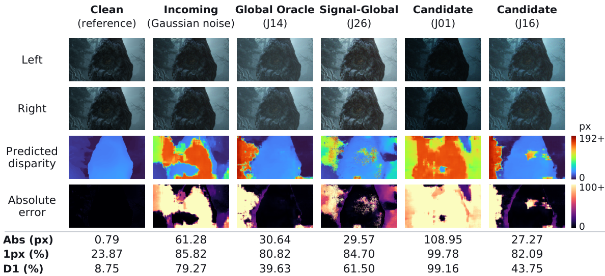
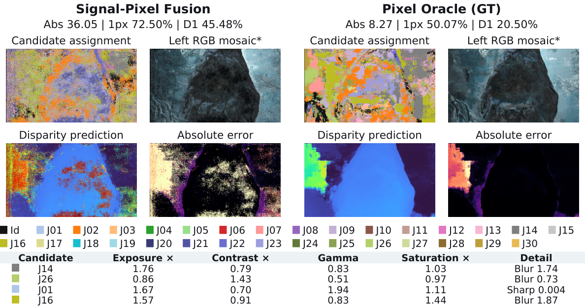

**Stereo robustness without retraining: internal risk-guided test-time input selection and disparity fusion.**

# From Failure Observability to Risk-Guided Input Adaptation in Stereo Matching (NeurIPS 2026 Workshop)

**RoCo-Spring: The Robust Correspondence Challenge**  
Exploration Track · Stereo Estimation

[paper](https://openreview.net/forum?id=tG2S5yNu2a) · [challenge](https://roco-spring.github.io/) · [submission: M03](https://spring-benchmark.org/531/)

Official implementation of our paper on failure observability and risk-guided
input adaptation for stereo matching. We investigate how internal signals in
frozen RAFT-Stereo and ACVNet track image difficulty, localize disparity errors,
and guide input selection and pixel-wise prediction fusion. On the held-out
evaluation split, Signal-Global reduces six-corruption macro D1 from **15.85% to
12.89%** for RAFT-Stereo and **30.12% to 18.72%** for ACVNet, relative reductions
of **18.6%** and **37.8%**, respectively, averaged over three assignments.

Building on these findings, we apply risk-guided selection to CroCo-Stereo
Spring-FT. Eight-candidate global selection reduces native clean-to-corrupted
prediction disagreement (ΔAbs) from **2.351 to 2.039 px (13.3%)**. Our entry,
**RoCo-67-M03**, achieves **RbS 0.1367** and ranked **2nd on the public Stereo
Matching robustness leaderboard as of 15 October 2026**. The code reproduces
the predictions, selection, and submission files for this entry.

## Results

### Paper experiments

Held-out evaluation: **172 pairs from 12 sequences**, six-corruption equal macro,
averaged over three assignments. Each input has **31 candidates**, including
Identity. Lower is better; Source / Clean is a separate reference.

<table>
  <thead>
    <tr>
      <th rowspan="2" align="left">Method</th>
      <th colspan="3" align="center">RAFT-Stereo</th>
      <th colspan="3" align="center">ACVNet</th>
    </tr>
    <tr>
      <th align="right">Abs (px)</th>
      <th align="right">1px (%)</th>
      <th align="right">D1 (%)</th>
      <th align="right">Abs (px)</th>
      <th align="right">1px (%)</th>
      <th align="right">D1 (%)</th>
    </tr>
  </thead>
  <tbody>
    <tr>
      <td align="left">Source / Clean</td>
      <td align="right">0.59</td>
      <td align="right">14.04</td>
      <td align="right">3.62</td>
      <td align="right">0.74</td>
      <td align="right">15.46</td>
      <td align="right">2.33</td>
    </tr>
    <tr>
      <td align="left">Identity</td>
      <td align="right">5.36</td>
      <td align="right">29.02</td>
      <td align="right">15.85</td>
      <td align="right">27.49</td>
      <td align="right">43.96</td>
      <td align="right">30.12</td>
    </tr>
    <tr>
      <td align="left">Random</td>
      <td align="right">8.55</td>
      <td align="right">30.72</td>
      <td align="right">17.19</td>
      <td align="right">33.36</td>
      <td align="right">49.50</td>
      <td align="right">35.28</td>
    </tr>
    <tr>
      <td align="left">Fixed-best</td>
      <td align="right">6.80</td>
      <td align="right">27.46</td>
      <td align="right">13.22</td>
      <td align="right">9.06</td>
      <td align="right">41.90</td>
      <td align="right">18.37</td>
    </tr>
    <tr>
      <td align="left"><strong>Signal-Global</strong></td>
      <td align="right"><strong>3.45</strong></td>
      <td align="right"><strong>26.51</strong></td>
      <td align="right"><strong>12.89</strong></td>
      <td align="right"><strong>9.58</strong></td>
      <td align="right"><strong>38.08</strong></td>
      <td align="right"><strong>18.72</strong></td>
    </tr>
    <tr>
      <td align="left"><strong>Signal-Pixel</strong></td>
      <td align="right"><strong>5.66</strong></td>
      <td align="right"><strong>26.61</strong></td>
      <td align="right"><strong>13.47</strong></td>
      <td align="right"><strong>11.99</strong></td>
      <td align="right"><strong>38.16</strong></td>
      <td align="right"><strong>18.32</strong></td>
    </tr>
    <tr>
      <td align="left">Global Oracle</td>
      <td align="right">5.37</td>
      <td align="right">26.18</td>
      <td align="right">11.53</td>
      <td align="right">5.67</td>
      <td align="right">37.68</td>
      <td align="right">13.38</td>
    </tr>
    <tr>
      <td align="left">Pixel Oracle</td>
      <td align="right">2.23</td>
      <td align="right">18.73</td>
      <td align="right">9.28</td>
      <td align="right">2.55</td>
      <td align="right">22.09</td>
      <td align="right">7.76</td>
    </tr>
  </tbody>
</table>

Fixed-best uses one development-selected transformation shared across both models.
Signal-Global selects one candidate per image; Signal-Pixel fuses their disparity
predictions locally. Global Oracle minimizes D1 (ties: Abs, then 1px); Pixel Oracle
minimizes absolute error. Both oracles use evaluation ground truth.
[Full values and confidence intervals](docs/results/paper_adaptation.csv).

### RoCo-Spring challenge

CroCo-Stereo Spring-FT with **eight fixed candidates** and Tile Global selection,
evaluated on **1,000 stereo pairs, both eyes, and 20 corruptions**. Lower is better.

<table>
  <thead>
    <tr>
      <th rowspan="2" align="left">Method</th>
      <th align="center">Native evaluation</th>
      <th colspan="3" align="center">Server evaluation</th>
    </tr>
    <tr>
      <th align="right">ΔAbs (px)</th>
      <th align="right">Clean Abs (px)</th>
      <th align="right">ΔAbs (px)</th>
      <th align="right">RbS</th>
    </tr>
  </thead>
  <tbody>
    <tr>
      <td align="left">Identity</td>
      <td align="right">2.351</td>
      <td align="right">—</td>
      <td align="right">—</td>
      <td align="right">—</td>
    </tr>
    <tr>
      <td align="left">Tile Global (M03)</td>
      <td align="right">2.039</td>
      <td align="right">0.474</td>
      <td align="right">2.040</td>
      <td align="right">0.1367</td>
    </tr>
  </tbody>
</table>

Tile Global reduces native clean-to-corrupted prediction disagreement by **13.3%**. M03 ranked
**2nd on the public Stereo Matching robustness leaderboard as of 15 October 2026**.
ΔAbs measures prediction disagreement, not corrupted-image GT error. Native and
server evaluations use different sampling; RbS is computed from the reported
server metrics. See [challenge details](docs/CHALLENGE.md) for the evaluation
settings and precision provenance.

## Qualitative Results

ACVNet on Gaussian-noise pair **0014/0154**, a predeclared held-out example from
assignment 101 with the paper's 31-candidate bank.

### Global input selection



Signal-Global reduces D1 from **79.27% to 61.50%** in this example; different
transformations produce different spatial error patterns.

### Pixel-wise disparity fusion



Signal-Pixel reaches **45.48% D1**, while Pixel Oracle reaches **20.50%**, illustrating
spatial complementarity and the remaining gap in risk-guided fusion. Colors identify
candidates. RGB mosaics illustrate assignments; fusion combines disparity predictions
without re-inference. Pixel Oracle is a GT-based diagnostic upper bound.

## Reproduce reported results

After [environment setup](docs/SETUP.md), use the included results to reproduce
the tables and plot previews on CPU. These commands require no datasets,
checkpoints, or GPU inference.

### Paper

```bash
python reproduce.py paper report --run-id paper
```

Reaggregate saved per-observation task metrics into the final tables, including
shared Fixed-best, consensus, denoising, and clean-input comparisons. Proxy
plots use the included summary CSVs. See [paper analysis](docs/PAPER.md) for
outputs and pixel-level recomputation from prediction caches.

### Challenge

```bash
python reproduce.py challenge report --run-id challenge-results
```

Reproduce the archived M03 server-score tables and saved clean-to-corrupted
prediction-disagreement summaries. This reports the recorded evaluation;
new predictions are evaluated separately.

## Run inference from scratch

Follow the [inference guide](docs/INFERENCE.md) to download data and pretrained
weights, generate predictions, and analyze the saved outputs:

- **Paper:** RAFT-Stereo and ACVNet, frozen signals and 31 input candidates.
- **Challenge:** CroCo-Stereo Spring-FT, eight candidates and Tile Global
  selection, followed by ΔAbs evaluation and submission-file generation.

The guide links the exact model settings, required caches, and commands for
each stage. All command inputs and outputs are listed in the
[command guide](docs/COMMANDS.md).

## References

Our implementation builds on the code released in
[RAFT-Stereo](https://github.com/princeton-vl/RAFT-Stereo),
[ACVNet](https://github.com/gangweiX/ACVNet), and
[CroCo](https://github.com/naver/croco). We use the
[Spring](https://spring-benchmark.org/) and
[RobustSpring](https://roco-spring.github.io/) datasets.

```bibtex
@inproceedings{lipson2021raft,
  title={{RAFT-Stereo}: Multilevel Recurrent Field Transforms for Stereo Matching},
  author={Lipson, Lahav and Teed, Zachary and Deng, Jia},
  booktitle={International Conference on 3D Vision}, year={2021},
  url={https://arxiv.org/abs/2109.07547}
}

@inproceedings{xu2022attention,
  title={Attention Concatenation Volume for Accurate and Efficient Stereo Matching},
  author={Xu, Gangwei and Cheng, Junda and Guo, Peng and Yang, Xin},
  booktitle={Proceedings of the IEEE/CVF Conference on Computer Vision and Pattern Recognition},
  pages={12981--12990}, year={2022},
  url={https://arxiv.org/abs/2203.02146}
}

@inproceedings{croco_v2,
  title={{CroCo v2: Improved Cross-view Completion Pre-training for Stereo Matching and Optical Flow}},
  author={Weinzaepfel, Philippe and Lucas, Thomas and Leroy, Vincent and Cabon, Yohann and Arora, Vaibhav and Br{\'e}gier, Romain and Csurka, Gabriela and Antsfeld, Leonid and Chidlovskii, Boris and Revaud, J{\'e}r{\^o}me}, 
  booktitle={ICCV},
  year={2023}
}

@inproceedings{mehl2023spring,
  title={Spring: A High-Resolution High-Detail Dataset and Benchmark for Scene Flow, Optical Flow and Stereo},
  author={Mehl, Lukas and Schmalfuss, Jenny and Jahedi, Azin and Nalivayko, Yaroslava and Bruhn, Andr{\'e}s},
  booktitle={Proceedings of the IEEE/CVF Conference on Computer Vision and Pattern Recognition},
  pages={4981--4991}, year={2023},
  url={https://openaccess.thecvf.com/content/CVPR2023/html/Mehl_Spring_A_High-Resolution_High-Detail_Dataset_and_Benchmark_for_Scene_Flow_CVPR_2023_paper.html}
}

@inproceedings{oei2026robustspring,
 title={RobustSpring: Benchmarking Robustness to Image Corruptions for Optical Flow, Scene Flow and Stereo},
 author={Oei, Victor and Schmalfuss, Jenny and Mehl, Lukas and Bartsch, Madlen and Agnihotri, Shashank and Keuper, Margret and Bulling, Andreas and Bruhn, Andr{\'e}s},
 booktitle={International Conference on Learning Representations}, year={2026},
 url={https://openreview.net/forum?id=RebPBMrMmk}
}
```

Additional model and software references are listed in
[references](docs/REFERENCES.md).

## Acknowledgments

This work was supported by the National Research Foundation of Korea (NRF) grant
funded by the Korea government (MSIT) (No. RS-2026-25559896). This research was
supported by a grant of the Medical data-driven hospital support project through
the Korea Health Information Service (KHIS), funded by the Ministry of Health &
Welfare, Republic of Korea.

## License

Our original code is released under the [MIT License](LICENSE).
External code, derived components, and model weights retain their
[upstream licenses](THIRD_PARTY.md).

## Citation

```bibtex
@inproceedings{
baek2026from,
title={From Failure Observability to Risk-Guided Input Adaptation in Stereo Matching},
author={Eunsu Baek},
booktitle={RoCo-Spring: The Robust Correspondence Challenge},
year={2026},
url={https://openreview.net/forum?id=tG2S5yNu2a}
}
```
